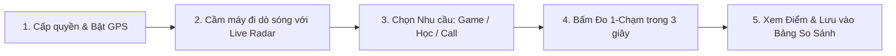

# HƯỚNG DẪN CÀI ĐẶT, CHẠY VÀ SỬ DỤNG ỨNG DỤNG
# WI-FI LOCATION OPTIMIZER (WLO)

---

## PHẦN 1: YÊU CẦU HỆ THỐNG & MÔI TRƯỜNG

* **Phần mềm:** Android Studio (Bản *Hedgehog 2023.1.1* hoặc mới hơn).
* **JDK:** Java 17 (Cấu hình mặc định trong Android Studio hiện đại).
* **Thiết bị chạy:**
  * **Khuyên dùng:** Điện thoại Android thật (Hệ điều hành Android 8.0 / API 26 trở lên). *Máy thật sẽ đo được chính xác dao động sóng dBm khi bạn di chuyển trong phòng.*
  * **Máy ảo (Emulator):** Android Emulator chạy Google APIs (API 30 - 34).

---

## PHẦN 2: HƯỚNG DẪN MỞ VÀ CHẠY DỰ ÁN (HOW TO RUN)

### Bước 1: Mở Dự án trong Android Studio
1. Khởi động **Android Studio**.
2. Trên màn hình chào mừng, chọn **Open** (hoặc vào `File > Open...`).
3. Điều hướng và chọn thư mục dự án:
   ```text
   d:\file_hoc_tap\Nam 4-ki 1\Phát triển Ứng dụng trên Thiết bị Di động\mobile_wifi_optimizer
   ```
4. Bấm **OK**. Chờ 1 - 2 phút để Android Studio tải các thư viện và hoàn tất **Gradle Sync**.

### Bước 2: Kiểm tra cấu hình Java 17 (Nếu cần)
* Vào `File > Settings` (trên Windows) $\rightarrow$ `Build, Execution, Deployment > Build Tools > Gradle`.
* Đảm bảo mục **Gradle JDK** đang chọn **Java 17** (Embedded JDK 17).

### Bước 3: Chạy ứng dụng lên Điện thoại / Máy ảo
1. **Nếu dùng Điện thoại thật:**
   * Bật **Chế độ nhà phát triển (Developer Options)** và kích hoạt **USB Debugging (Gỡ lỗi USB)** trên điện thoại.
   * Cắm cáp kết nối điện thoại vào máy tính và chọn *"Luôn cho phép gỡ lỗi từ máy tính này"*.
2. **Nếu dùng Máy ảo (Emulator):**
   * Khởi động một máy ảo bất kỳ từ Device Manager.
3. Nhìn lên thanh công cụ trên cùng của Android Studio, chọn thiết bị của bạn và bấm nút **Run 'app'** (Hình tam giác màu xanh lá ▶ hoặc phím tắt `Shift + F10`).

### Bước 4: Chạy kiểm thử tự động (Unit Tests)
* Trong cửa sổ `Project` bên trái, duyệt tới: `app > src > test > java > com.mobilelegend.wlo`.
* Chuột phải vào thư mục `wlo` và chọn **Run 'Tests in 'com.mobilelegend.wlo''**.
* Toàn bộ các bài test sẽ chạy và hiển thị dấu tích xanh lá (Passed 100%).

---

## PHẦN 3: HƯỚNG DẪN SỬ DỤNG ỨNG DỤNG (USER MANUAL)



### 📍 Bước 1: Khởi động & Cấp quyền thông minh
* Khi mở app lần đầu, hệ thống sẽ hiện thông báo xin quyền Vị trí $\rightarrow$ Chọn **"Trong khi dùng ứng dụng"**.
* **Lưu ý quan trọng:** Hãy bật tính năng **Vị trí (GPS)** của điện thoại. *(Android yêu cầu bật GPS để ứng dụng đọc được tên Wi-Fi và cường độ sóng RSSI).*
* Nếu quên bật GPS, app sẽ hiển thị một Banner màu vàng $\rightarrow$ Bấm nút **"Bật GPS"** để được dẫn thẳng vào cài đặt.

---

### 📍 Bước 2: Đi tìm vùng sóng tốt với "Live Wi-Fi Radar"
* Tại màn hình chính, bạn sẽ thấy:
  * Tên mạng Wi-Fi (SSID) và địa chỉ MAC thiết bị đang kết nối.
  * Tốc độ lý thuyết (LinkSpeed Mbps) và Băng tần ($2.4\text{ GHz}$ hoặc $5.0\text{ GHz}$).
  * **Đồng hồ Gauge trung tâm:** Chỉ số dBm và phần trăm vạch sóng cập nhật liên tục mỗi **1 giây**.
* **Cách sử dụng:** Cầm điện thoại đi dạo quanh các vị trí trong phòng (Bàn học, Giường ngủ, Gần cửa sổ, Ban công...).
  * **Vùng Xanh lá ($\ge -60\text{ dBm}$):** Sóng rất mạnh, vị trí đắc địa.
  * **Vùng Vàng ($-61 \to -75\text{ dBm}$):** Sóng trung bình khá.
  * **Vùng Đỏ ($\le -76\text{ dBm}$):** Sóng yếu, xa router, dễ chập chờn.

---

### 📍 Bước 3: Chọn nhu cầu sử dụng
Ngay dưới đồng hồ đo sóng, chọn 1 trong 3 nhu cầu của bạn:
1. 🎮 **Chơi Game (Gaming):** Ưu tiên độ trễ Ping thấp nhất, không giật lag.
2. 📚 **Học tập & Tải File (Study / Download):** Ưu tiên băng thông và tốc độ tải lớn.
3. 📞 **Họp & Học Online (Video Call):** Ưu tiên tín hiệu sóng ổn định và Ping vừa phải.

---

### 📍 Bước 4: Bấm "Kiểm tra 1-Chạm Vị trí Này (3s)"
* Khi đã đứng ở vị trí bạn muốn ngồi, bấm nút **"Kiểm tra 1-Chạm Vị trí Này (3s)"**.
* Màn hình sẽ hiển thị tiến trình đo 3 giây kèm hiệu ứng sóng Radar Pulse:
  * *Giây 1:* Thu thập thông số phần cứng.
  * *Giây 2:* Bắn 3 gói tin TCP Socket tới DNS `1.1.1.1:53` để đo độ trễ thực tế.
  * *Giây 3:* Scoring Engine áp trọng số và tính điểm.

---

### 📍 Bước 5: Xem Kết Quả & Lời Khuyên
Màn hình Kết quả sẽ hiển thị:
* **Vòng tròn điểm số ($0 - 100$ điểm):** Màu sắc tương ứng với mức độ đạt chuẩn.
* **Lời nhận xét & Khuyến nghị:** Đưa ra lời khuyên cụ thể (VD: *"Tuyệt vời để Leo Rank Liên Quân"* hoặc *"Băng thông bị bóp nghẹt, hãy đổi vị trí gần router hơn"*).
* **Bảng phân tích 3 thông số chi tiết:**
  * Độ trễ Ping (ms).
  * Cường độ sóng (dBm).
  * Tốc độ kết nối (Mbps).

---

### 📍 Bước 6: Lưu và So sánh giữa các vị trí trong phòng
1. Trên màn hình kết quả, bấm nút **"Lưu vị trí này"** $\rightarrow$ Đặt tên (VD: *"Bàn học gần cửa"*).
2. Bấm **"Về Radar dò tiếp"** $\rightarrow$ Đi sang vị trí khác (VD: *"Giường ngủ"*) và bấm đo kiểm tra lại.
3. Bấm nút **"So sánh"** ở góc trên màn hình:
   * Một Bottom Sheet trượt lên hiển thị bảng xếp hạng các vị trí đã đo.
   * Vị trí có điểm số cao nhất sẽ được tự động trao huy hiệu 🏆 **"TỐT NHẤT"**.

---

## PHẦN 4: Ý NGHĨA CÁC CHỈ SỐ KỸ THUẬT

| Chỉ số | Ý nghĩa | Mức Tốt | Mức Kém |
| :--- | :--- | :---: | :---: |
| **RSSI (dBm)** | Cường độ tín hiệu sóng nhận được | $\ge -60\text{ dBm}$ | $\le -80\text{ dBm}$ |
| **Ping (ms)** | Thời gian phản hồi mạng (Độ trễ) | $\le 40\text{ ms}$ | $\ge 120\text{ ms}$ |
| **LinkSpeed (Mbps)** | Tốc độ kết nối lý thuyết giữa máy và Router | $\ge 150\text{ Mbps}$ | $\le 20\text{ Mbps}$ |

---

## PHẦN 5: CÂU HỎI THƯỜNG GẶP & XỬ LÝ SỰ CỐ (FAQ)

* **Hỏi: Tại sao tên Wi-Fi hiện chuỗi `"<unknown ssid>"` hoặc `"Mạng Wi-Fi (Cần bật GPS)"`?**
  * *Trả lời:* Từ Android 10 trở lên, Google yêu cầu bắt buộc phải bật **Vị trí (GPS)** thì ứng dụng mới được đọc tên Wi-Fi và cường độ dBm. Bạn chỉ cần bật GPS của điện thoại lên là xong.
* **Hỏi: Nút "Kiểm tra 1-Chạm" bị mờ (vô hiệu hóa), không bấm được?**
  * *Trả lời:* Điện thoại của bạn chưa kết nối vào mạng Wi-Fi nào (đang tắt Wi-Fi hoặc đang dùng mạng di động 4G/5G). Hãy bật Wi-Fi lên để kích hoạt nút đo.
* **Hỏi: Làm sao xóa bớt một vị trí trong bảng so sánh?**
  * *Trả lời:* Mở bảng "So sánh", bấm vào biểu tượng thùng rác màu xám cạnh vị trí muốn xóa.
