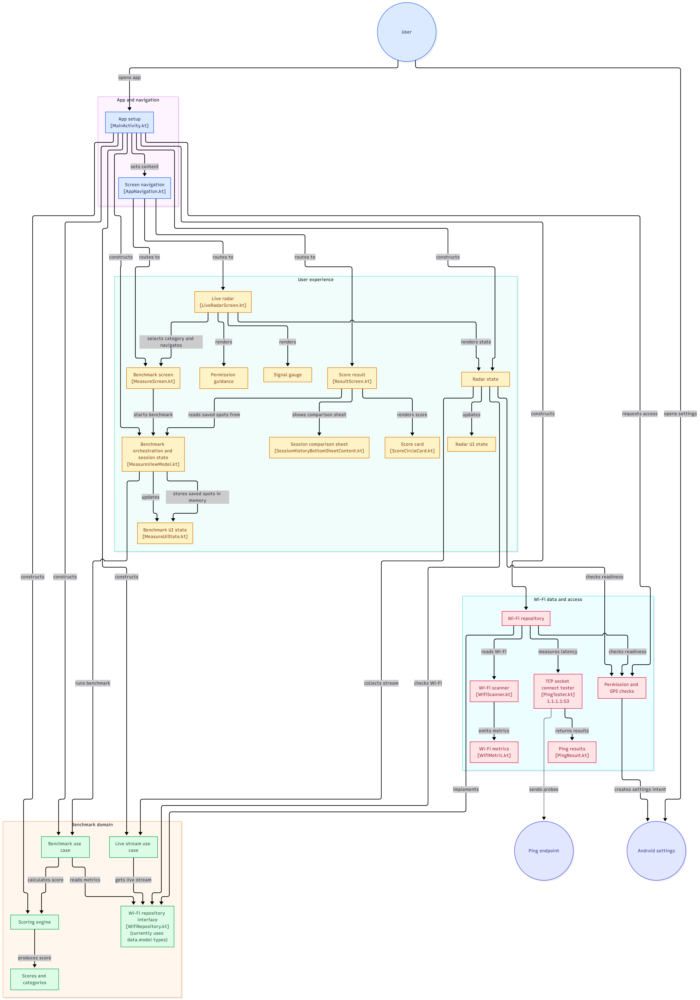

# 🏛️ Kiến Trúc Hệ Thống (System Architecture)

Tài liệu mô tả kiến trúc tổng thể và luồng tương tác giữa các tầng Clean Architecture + MVVM trong ứng dụng **Wi-Fi Location Optimizer (WLO)**.

---

## 📊 Sơ Đồ Chi Tiết (Interactive Mermaid Diagram)

```mermaid
%% Generated by https://gitdiagram.com/rumeodinhau/mobile_wifi_optimizer
flowchart TD

subgraph group_app["App and navigation"]
  node_activity["App setup<br/>[MainActivity.kt]"]
  node_navigation["Screen navigation<br/>[AppNavigation.kt]"]
end

subgraph group_presentation["User experience"]
  node_radar["Live radar<br/>[LiveRadarScreen.kt]"]
  node_radar_vm["Radar state"]
  node_radar_state["Radar UI state"]
  node_gauge["Signal gauge"]
  node_permission_ui["Permission guidance"]
  node_measure["Benchmark screen<br/>[MeasureScreen.kt]"]
  node_measure_vm["Benchmark orchestration and session state<br/>[MeasureViewModel.kt]"]
  node_measure_state["Benchmark UI state<br/>[MeasureUiState.kt]"]
  node_result["Score result<br/>[ResultScreen.kt]"]
  node_history["Session comparison sheet<br/>[SessionHistoryBottomSheetContent.kt]"]
  node_score_card["Score card<br/>[ScoreCircleCard.kt]"]
end

subgraph group_domain["Benchmark domain"]
  node_stream_usecase["Live stream use case"]
  node_benchmark_usecase["Benchmark use case"]
  node_scoring["Scoring engine"]
  node_domain_models["Scores and categories"]
  node_repository_api["Wi-Fi repository interface<br/>[WifiRepository.kt]<br/>(currently uses data.model types)"]
end

subgraph group_data["Wi-Fi data and access"]
  node_repository_impl["Wi-Fi repository"]
  node_scanner["Wi-Fi scanner<br/>[WifiScanner.kt]"]
  node_metrics["Wi-Fi metrics<br/>[WifiMetric.kt]"]
  node_ping_result["Ping results<br/>[PingResult.kt]"]
  node_ping["TCP socket connect tester<br/>[PingTester.kt]<br/>1.1.1.1:53"]
  node_permissions["Permission and GPS checks"]
end

node_user(("User"))
node_network(("Ping endpoint"))
node_settings(("Android settings"))

node_user -->|"opens app"| node_activity
node_activity -->|"sets content"| node_navigation
node_activity -->|"constructs"| node_repository_impl
node_activity -->|"constructs"| node_stream_usecase
node_activity -->|"constructs"| node_scoring
node_activity -->|"constructs"| node_benchmark_usecase
node_activity -->|"constructs"| node_radar_vm
node_activity -->|"constructs"| node_measure_vm
node_navigation -->|"routes to"| node_radar
node_navigation -->|"routes to"| node_measure
node_navigation -->|"routes to"| node_result
node_radar -->|"renders state"| node_radar_vm
node_radar -->|"renders"| node_gauge
node_radar -->|"renders"| node_permission_ui
node_radar_vm -->|"collects stream"| node_stream_usecase
node_radar_vm -->|"checks Wi-Fi"| node_repository_api
node_radar_vm -->|"checks readiness"| node_permissions
node_radar_vm -->|"updates"| node_radar_state
node_radar -->|"selects category and navigates"| node_measure
node_measure -->|"starts benchmark"| node_measure_vm
node_measure_vm -->|"runs benchmark"| node_benchmark_usecase
node_measure_vm -->|"updates"| node_measure_state
node_measure_vm -->|"stores saved spots in memory"| node_measure_state
node_result -->|"reads saved spots from"| node_measure_vm
node_result -->|"shows comparison sheet"| node_history
node_result -->|"renders score"| node_score_card
node_benchmark_usecase -->|"reads metrics"| node_repository_api
node_benchmark_usecase -->|"calculates score"| node_scoring
node_scoring -->|"produces score"| node_domain_models
node_stream_usecase -->|"gets live stream"| node_repository_api
node_repository_impl -->|"implements"| node_repository_api
node_repository_impl -->|"reads Wi-Fi"| node_scanner
node_repository_impl -->|"measures latency"| node_ping
node_repository_impl -->|"checks readiness"| node_permissions
node_scanner -->|"emits metrics"| node_metrics
node_ping -->|"returns results"| node_ping_result
node_ping -.->|"sends probes"| node_network
node_user -->|"opens settings"| node_settings
node_activity -->|"requests access"| node_permissions
node_permissions -->|"creates settings intent"| node_settings

click node_activity "https://github.com/rumeodinhau/mobile_wifi_optimizer/blob/main/app/src/main/java/com/mobilelegend/wlo/MainActivity.kt"
click node_navigation "https://github.com/rumeodinhau/mobile_wifi_optimizer/blob/main/app/src/main/java/com/mobilelegend/wlo/presentation/navigation/AppNavigation.kt"
click node_radar "https://github.com/rumeodinhau/mobile_wifi_optimizer/blob/main/app/src/main/java/com/mobilelegend/wlo/presentation/live_radar/LiveRadarScreen.kt"
click node_radar_vm "https://github.com/rumeodinhau/mobile_wifi_optimizer/blob/main/app/src/main/java/com/mobilelegend/wlo/presentation/live_radar/LiveRadarViewModel.kt"
click node_radar_state "https://github.com/rumeodinhau/mobile_wifi_optimizer/blob/main/app/src/main/java/com/mobilelegend/wlo/presentation/live_radar/LiveRadarUiState.kt"
click node_gauge "https://github.com/rumeodinhau/mobile_wifi_optimizer/blob/main/app/src/main/java/com/mobilelegend/wlo/presentation/components/SignalGaugeIndicator.kt"
click node_permission_ui "https://github.com/rumeodinhau/mobile_wifi_optimizer/blob/main/app/src/main/java/com/mobilelegend/wlo/presentation/components/PermissionBanner.kt"
click node_measure "https://github.com/rumeodinhau/mobile_wifi_optimizer/blob/main/app/src/main/java/com/mobilelegend/wlo/presentation/measure_and_result/MeasureScreen.kt"
click node_measure_vm "https://github.com/rumeodinhau/mobile_wifi_optimizer/blob/main/app/src/main/java/com/mobilelegend/wlo/presentation/measure_and_result/MeasureViewModel.kt"
click node_measure_state "https://github.com/rumeodinhau/mobile_wifi_optimizer/blob/main/app/src/main/java/com/mobilelegend/wlo/presentation/measure_and_result/MeasureUiState.kt"
click node_result "https://github.com/rumeodinhau/mobile_wifi_optimizer/blob/main/app/src/main/java/com/mobilelegend/wlo/presentation/measure_and_result/ResultScreen.kt"
click node_history "https://github.com/rumeodinhau/mobile_wifi_optimizer/blob/main/app/src/main/java/com/mobilelegend/wlo/presentation/measure_and_result/SessionHistoryBottomSheetContent.kt"
click node_score_card "https://github.com/rumeodinhau/mobile_wifi_optimizer/blob/main/app/src/main/java/com/mobilelegend/wlo/presentation/components/ScoreCircleCard.kt"
click node_stream_usecase "https://github.com/rumeodinhau/mobile_wifi_optimizer/blob/main/app/src/main/java/com/mobilelegend/wlo/domain/usecase/StreamLiveWifiUseCase.kt"
click node_benchmark_usecase "https://github.com/rumeodinhau/mobile_wifi_optimizer/blob/main/app/src/main/java/com/mobilelegend/wlo/domain/usecase/PerformBenchmarkUseCase.kt"
click node_scoring "https://github.com/rumeodinhau/mobile_wifi_optimizer/blob/main/app/src/main/java/com/mobilelegend/wlo/domain/usecase/CalculateScoreUseCase.kt"
click node_domain_models "https://github.com/rumeodinhau/mobile_wifi_optimizer/tree/main/app/src/main/java/com/mobilelegend/wlo/domain/model"
click node_repository_api "https://github.com/rumeodinhau/mobile_wifi_optimizer/blob/main/app/src/main/java/com/mobilelegend/wlo/domain/repository/WifiRepository.kt"
click node_repository_impl "https://github.com/rumeodinhau/mobile_wifi_optimizer/blob/main/app/src/main/java/com/mobilelegend/wlo/data/repository_impl/WifiRepositoryImpl.kt"
click node_scanner "https://github.com/rumeodinhau/mobile_wifi_optimizer/blob/main/app/src/main/java/com/mobilelegend/wlo/data/sensor/WifiScanner.kt"
click node_metrics "https://github.com/rumeodinhau/mobile_wifi_optimizer/blob/main/app/src/main/java/com/mobilelegend/wlo/data/model/WifiMetric.kt"
click node_ping_result "https://github.com/rumeodinhau/mobile_wifi_optimizer/blob/main/app/src/main/java/com/mobilelegend/wlo/data/model/PingResult.kt"
click node_ping "https://github.com/rumeodinhau/mobile_wifi_optimizer/blob/main/app/src/main/java/com/mobilelegend/wlo/core/network/PingTester.kt"
click node_permissions "https://github.com/rumeodinhau/mobile_wifi_optimizer/blob/main/app/src/main/java/com/mobilelegend/wlo/core/permissions/PermissionHelper.kt"

classDef toneNeutral fill:#f8fafc,stroke:#334155,stroke-width:1.5px,color:#0f172a
classDef toneBlue fill:#dbeafe,stroke:#2563eb,stroke-width:1.5px,color:#172554
classDef toneAmber fill:#fef3c7,stroke:#d97706,stroke-width:1.5px,color:#78350f
classDef toneMint fill:#dcfce7,stroke:#16a34a,stroke-width:1.5px,color:#14532d
classDef toneRose fill:#ffe4e6,stroke:#e11d48,stroke-width:1.5px,color:#881337
classDef toneIndigo fill:#e0e7ff,stroke:#4f46e5,stroke-width:1.5px,color:#312e81
classDef toneTeal fill:#ccfbf1,stroke:#0f766e,stroke-width:1.5px,color:#134e4a
class node_activity,node_navigation,node_user toneBlue
class node_radar,node_radar_vm,node_radar_state,node_gauge,node_permission_ui,node_measure,node_measure_vm,node_measure_state,node_result,node_history,node_score_card toneAmber
class node_stream_usecase,node_benchmark_usecase,node_scoring,node_domain_models,node_repository_api toneMint
class node_repository_impl,node_scanner,node_metrics,node_ping_result,node_ping,node_permissions toneRose
class node_network,node_settings toneIndigo
```

