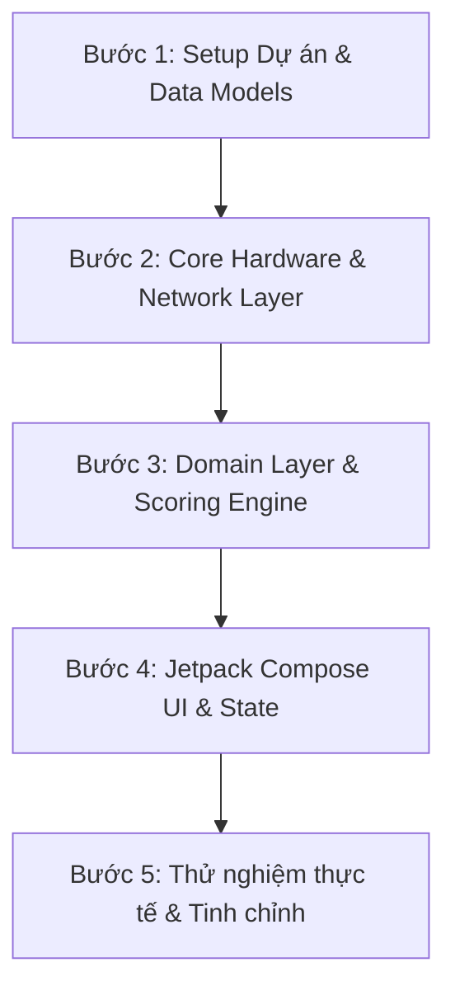

# TÀI LIỆU LƯU Ý & HƯỚNG DẪN KỸ THUẬT TRIỂN KHAI (WLO)

Tài liệu này tổng hợp các lưu ý kỹ thuật chuyên sâu, giải pháp tương thích phần cứng Android, xử lý ngoại lệ và công thức toán học cho Scoring Engine trước khi bắt đầu viết code dự án **Wi-Fi Location Optimizer (WLO)**.

---

## 1. Lưu ý về Android API & Quyền hạn (Compatibility)

### 1.1. Tương thích API lấy thông tin Wi-Fi (Android 11 vs Android 12+)
* **Vấn đề:** `WifiManager.connectionInfo` đã bị đánh dấu **Deprecated** từ Android 12 (API 31).
* **Giải pháp đa phiên bản:**
  * **Android 11 (API 30) trở xuống:** Sử dụng `WifiManager.getConnectionInfo()`.
  * **Android 12 (API 31) trở lên:** Sử dụng `ConnectivityManager` kết hợp `NetworkCapabilities`:
    ```kotlin
    val network = connectivityManager.activeNetwork
    val capabilities = connectivityManager.getNetworkCapabilities(network)
    val wifiInfo = capabilities?.transportInfo as? WifiInfo
    ```

### 1.2. Vấn đề SSID bị ẩn (`<unknown ssid>`)
* Trên Android 8.0+, nếu chưa được cấp quyền vị trí hoặc dịch vụ định vị (GPS) đang tắt:
  * Hệ thống sẽ trả về SSID là `"<unknown ssid>"`.
  * BSSID trả về `"02:00:00:00:00:00"`.
  * RSSI trả về `-127 dBm` hoặc `0`.
* **Yêu cầu xử lý:**
  * Bắt buộc có luồng kiểm tra `LocationManager.isProviderEnabled(LocationManager.GPS_PROVIDER)` song song với kiểm tra quyền `ACCESS_FINE_LOCATION`.
  * Hiển thị Dialog hướng dẫn người dùng bật GPS trong Cài đặt nếu GPS đang tắt.

### 1.3. Khai báo quyền hạn trên Android 13+ (API 33)
* Khai báo trong `AndroidManifest.xml`:
  ```xml
  <uses-permission android:name="android.permission.INTERNET" />
  <uses-permission android:name="android.permission.ACCESS_NETWORK_STATE" />
  <uses-permission android:name="android.permission.ACCESS_WIFI_STATE" />
  <uses-permission android:name="android.permission.ACCESS_FINE_LOCATION" />
  <uses-permission android:name="android.permission.ACCESS_COARSE_LOCATION" />
  <!-- Dành riêng cho Android 13+ -->
  <uses-permission 
      android:name="android.permission.NEARBY_WIFI_DEVICES" 
      android:usesPermissionFlags="neverForLocation" />
  ```

---

## 2. Phương pháp đo Ping (ICMP Exec vs TCP Socket)

### 2.1. Phân tích ưu / nhược điểm
| Tiêu chí | Cách 1: ICMP Shell Command (`Runtime.exec`) | Cách 2: TCP Socket Connect (Khuyên dùng) |
| :--- | :--- | :--- |
| **Bản chất** | Chạy lệnh `/system/bin/ping -c 1 1.1.1.1` | Mở kết nối Socket tới `1.1.1.1:53` hoặc `8.8.8.8:53` |
| **Độ ổn định** | Kém trên một số dòng máy (bị chặn bởi SELinux, sandbox) | Rất cao, 100% thiết bị Android đều hỗ trợ |
| **Khả năng Parse** | Dễ lỗi regex nếu máy đổi ngôn ngữ hệ thống | Đo trực tiếp qua `System.currentTimeMillis()` |
| **Hiệu năng & Luồng** | Tạo process con tốn tài nguyên | Chạy nhẹ nhàng trong Coroutine `Dispatchers.IO` |

### 2.2. Triển khai chuẩn (TCP Socket với Timeout)
```kotlin
suspend fun measureSocketPing(host: String = "1.1.1.1", port: Int = 53, timeoutMs: Int = 2000): PingResult = withContext(Dispatchers.IO) {
    val startTime = System.currentTimeMillis()
    try {
        Socket().use { socket ->
            socket.connect(InetSocketAddress(host, port), timeoutMs)
        }
        val latency = System.currentTimeMillis() - startTime
        PingResult(latencyMs = latency, packetLossPercent = 0, isSuccess = true)
    } catch (e: Exception) {
        PingResult(latencyMs = timeoutMs.toLong(), packetLossPercent = 100, isSuccess = false)
    }
}
```

---

## 3. Xử lý các trạng thái biên (Edge Cases)

| Trường hợp biên | Biểu hiện | Cách xử lý trong App |
| :--- | :--- | :--- |
| **Chưa kết nối Wi-Fi** (Đang dùng 4G hoặc Offline) | `capabilities.hasTransport(TRANSPORT_WIFI) == false` | Màn hình Live Radar hiển thị thông báo/card cảnh báo: *"Chưa kết nối Wi-Fi. Vui lòng kết nối để dò sóng."*, vô hiệu hoá nút đo. |
| **Chưa bật GPS / Chưa cấp quyền** | Không lấy được SSID / RSSI | Hiển thị Banner Onboarding / 1-Click dẫn thẳng vào `Settings.ACTION_LOCATION_SOURCE_SETTINGS`. |
| **Mất mạng đột ngột khi đang đo** | Socket timeout / Exception trong tiến trình 3 giây | Bắt ngoại lệ (`catch Exception`), trả về trạng thái đo thất bại và gợi ý thử lại thay vì crash app. |
| **Mạng Wi-Fi không có Internet** | Wi-Fi connected nhưng Ping 100% timeout | Đánh giá điểm tổng = 0, ghi rõ lý do: *"Wi-Fi không có tín hiệu Internet"*. |

---

## 4. Công thức chuẩn hóa (Normalization) cho Scoring Engine

### 4.1. Công thức tổng quát
$$\text{FinalScore} = \text{round}\left( S_{\text{RSSI}} \times W_{\text{RSSI}} + S_{\text{Ping}} \times W_{\text{Ping}} + S_{\text{Speed}} \times W_{\text{Speed}} \right)$$

Trong đó:
* $S_{\text{RSSI}}, S_{\text{Ping}}, S_{\text{Speed}} \in [0, 100]$: Điểm thành phần đã chuẩn hóa.
* $W_{\text{RSSI}} + W_{\text{Ping}} + W_{\text{Speed}} = 1.0$: Bộ trọng số theo nhu cầu.

### 4.2. Chi tiết hàm chuẩn hóa từng chỉ số
1. **Chuẩn hóa Cường độ sóng ($S_{\text{RSSI}}$):**
   * Ngưỡng tối ưu: $\ge -50\text{ dBm} \rightarrow 100$ điểm.
   * Ngưỡng rất yếu: $\le -90\text{ dBm} \rightarrow 0$ điểm.
   $$S_{\text{RSSI}} = \text{clamp}\left( \frac{\text{RSSI} - (-90)}{-50 - (-90)} \times 100,\ 0,\ 100 \right)$$

2. **Chuẩn hóa Độ trễ ($S_{\text{Ping}}$):**
   * Ngưỡng rất mượt: $\le 20\text{ ms} \rightarrow 100$ điểm.
   * Ngưỡng lag/timeout: $\ge 200\text{ ms} \rightarrow 0$ điểm.
   $$S_{\text{Ping}} = \text{clamp}\left( \frac{200 - \text{PingMs}}{200 - 20} \times 100,\ 0,\ 100 \right)$$

3. **Chuẩn hóa Tốc độ kết nối ($S_{\text{Speed}}$):**
   * Ngưỡng cao: $\ge 300\text{ Mbps} \rightarrow 100$ điểm.
   * Ngưỡng thấp: $\le 10\text{ Mbps} \rightarrow 0$ điểm.
   $$S_{\text{Speed}} = \text{clamp}\left( \frac{\text{LinkSpeed} - 10}{300 - 10} \times 100,\ 0,\ 100 \right)$$

### 4.3. Bảng trọng số theo nhu cầu (Use Case Weights)
| Use Case | $W_{\text{Ping}}$ (Độ trễ) | $W_{\text{RSSI}}$ (Cường độ sóng) | $W_{\text{Speed}}$ (Tốc độ) | Đánh giá tối thiểu khuyến nghị |
| :--- | :---: | :---: | :---: | :--- |
| **Gaming (Chơi game)** | **0.60** | **0.30** | **0.10** | Score $\ge 75$ & Ping $\le 60\text{ms}$ |
| **Study / Download (Tải tài liệu)** | **0.10** | **0.40** | **0.50** | Score $\ge 70$ & Speed $\ge 50\text{Mbps}$ |
| **Video Call (Họp/Học online)** | **0.40** | **0.40** | **0.20** | Score $\ge 70$ & Ping $\le 100\text{ms}$ |

---

## 5. Kế hoạch triển khai đề xuất



* **Bước 1: Setup Dự án & Data Models**
  * Khởi tạo project Android Studio với Jetpack Compose & Material 3.
  * Thiết lập `build.gradle.kts` (Coroutines, Navigation Compose, Material 3 Icons).
  * Viết các Data Class & Enum trong `data/model/` và `domain/model/`.
* **Bước 2: Core Hardware & Network Layer**
  * Viết `PermissionHelper` xử lý xin quyền và kiểm tra bật GPS.
  * Viết `WifiScanner` sử dụng `Flow` phát tín hiệu RSSI và LinkSpeed định kỳ mỗi 1 giây.
  * Viết `PingTester` đo socket latency bất đồng bộ với `Dispatchers.IO`.
* **Bước 3: Domain Layer & Scoring Engine**
  * Viết `CalculateScoreUseCase` áp dụng công thức chuẩn hóa và gán nhãn khuyến nghị.
  * Viết `StreamLiveWifiUseCase` kết nối dữ liệu từ Scanner tới ViewModel.
* **Bước 4: Jetpack Compose UI Layer**
  * Xây dựng `LiveRadarScreen`: La bàn sóng / Gauge đồng hồ đổi màu thời gian thực (Xanh/Vàng/Đỏ).
  * Xây dựng `MeasureBenchmarkScreen`: Nút đo 1-chạm 3 giây với animation tiến trình.
  * Xây dựng `ResultScreen` & `SessionHistorySheet`: Hiển thị điểm số, lời khuyên và so sánh giữa các vị trí.
* **Bước 5: Kiểm thử trên máy thật**
  * Kiểm thử bật/tắt GPS, bật/tắt Wi-Fi, chuyển vùng sóng xa gần Router.
