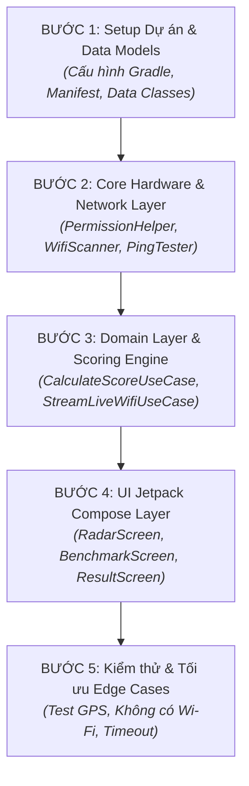

# KẾ HOẠCH & THỨ TỰ TRIỂN KHAI (IMPLEMENTATION ROADMAP)
**Dự án:** Wi-Fi Location Optimizer (WLO) Android App  
**Phương pháp tiếp cận:** Clean Architecture + MVVM (Bottom-Up / Từ trong ra ngoài)

---

## Sơ đồ Tổng quan Lộ trình

---

## Chi tiết Từng Bước Triển khai

### 📌 BƯỚC 1: Khởi tạo Khung Dự án & Mô hình Dữ liệu (Data Models)
> **Mục tiêu:** Chuẩn bị môi trường build, khai báo quyền hệ thống và định nghĩa các thực thể dữ liệu trong bộ nhớ RAM.

* **1.1. Cấu hình Gradle (`build.gradle.kts`):**
  * Android Gradle Plugin, Kotlin 1.9+.
  * Jetpack Compose (BOM, Material 3, UI Tooling).
  * `kotlinx-coroutines-android` & `lifecycle-viewmodel-compose`.
  * `androidx.navigation:navigation-compose`.
* **1.2. Khai báo quyền hệ thống (`AndroidManifest.xml`):**
  * `INTERNET`, `ACCESS_NETWORK_STATE`, `ACCESS_WIFI_STATE`.
  * `ACCESS_FINE_LOCATION`, `ACCESS_COARSE_LOCATION`.
  * `NEARBY_WIFI_DEVICES` (cho Android 13+).
* **1.3. Định nghĩa Data Models:**
  * `data/model/WifiMetric.kt`: SSID, BSSID, RSSI (dBm), LinkSpeed (Mbps), Frequency (MHz).
  * `data/model/PingResult.kt`: Latency (ms), PacketLoss (%), isSuccess.
  * `domain/model/UseCaseCategory.kt`: `GAMING`, `VIDEO_CALL`, `STUDY_DOWNLOAD`.
  * `domain/model/UseCaseWeight.kt`: Trọng số Ping, Sóng, Tốc độ.
  * `domain/model/LocationScore.kt`: Điểm tổng (0-100), Nhãn đánh giá, Lời khuyên.

---

### 📌 BƯỚC 2: Tầng Giao tiếp Phần cứng & Mạng (Core & Data Layer)
> **Mục tiêu:** Thu thập chính xác tín hiệu Wi-Fi và đo độ trễ mạng bất đồng bộ, không gây lag/đơ Main Thread.

* **2.1. Quản lý Quyền & Dịch vụ (`core/permissions/PermissionHelper.kt`):**
  * Kiểm tra quyền `ACCESS_FINE_LOCATION` và `NEARBY_WIFI_DEVICES`.
  * Kiểm tra dịch vụ định vị GPS (`LocationManager.isProviderEnabled(GPS_PROVIDER)`).
  * Hàm tiện ích mở màn hình Cài đặt hệ thống.
* **2.2. Đo Ping Socket (`core/network/PingTester.kt`):**
  * Triển khai mở Socket TCP tới `1.1.1.1:53` trên `Dispatchers.IO` với timeout 2000ms.
  * Tính độ trễ trung bình và tỷ lệ rớt gói sau 3 lần ping liên tiếp.
* **2.3. Trình đọc cảm biến Wi-Fi (`data/sensor/WifiScanner.kt`):**
  * Đọc `WifiInfo` tương thích đa phiên bản (Android 11 qua `WifiManager`, Android 12+ qua `ConnectivityManager.getNetworkCapabilities`).
  * Sử dụng Kotlin `Flow` để emit dữ liệu mỗi 1 giây (`Flow.sample(1000L)`).
* **2.4. Repository (`data/repository_impl/WifiRepositoryImpl.kt`):**
  * Đóng gói luồng dữ liệu từ `WifiScanner` và `PingTester` cung cấp cho Domain Layer.

---

### 📌 BƯỚC 3: Tầng Nghiệp vụ & Thuật toán Tính điểm (Domain Layer)
> **Mục tiêu:** Chuyển đổi dữ liệu kỹ thuật thô thành điểm số trực quan (0 - 100) theo từng nhu cầu sử dụng.

* **3.1. `StreamLiveWifiUseCase.kt`:**
  * Lấy luồng dữ liệu sóng thời gian thực và phân loại dải màu:
    * **Xanh lá:** `RSSI >= -60 dBm` (Rất tốt).
    * **Vàng:** `-61 đến -75 dBm` (Tạm ổn).
    * **Đỏ:** `<= -76 dBm` (Yếu).
* **3.2. `CalculateScoreUseCase.kt` (Scoring Engine):**
  * Chuẩn hóa (Normalize) các chỉ số RSSI, Ping, LinkSpeed về thang điểm $0 - 100$.
  * Áp dụng ma trận trọng số theo `UseCaseCategory`.
  * Sinh thông điệp khuyến nghị thông minh (VD: *"Đạt chuẩn Gaming: Ping 28ms cực kỳ mượt mà"*).

---

### 📌 BƯỚC 4: Tầng Giao diện Jetpack Compose (Presentation Layer)
> **Mục tiêu:** Giao diện Material 3 hiện đại, trực quan, cập nhật 60fps mượt mà theo cảm biến.

* **4.1. Design System & Reusable Components (`presentation/components/`):**
  * `SignalGaugeIndicator`: Đồng hồ đo sóng dạng Gauge đổi màu linh hoạt.
  * `ScoreCircleCard`: Vòng tròn hiển thị điểm số $0-100$ kèm hiệu ứng animate.
  * `StatusBadge`: Huy hiệu trạng thái kết nối (Connected/Disconnected/No GPS).
* **4.2. Màn hình Live Radar (`presentation/live_radar/`):**
  * `LiveRadarScreen.kt` + `LiveRadarViewModel.kt`.
  * Hiển thị SSID hiện tại, đồng hồ đo sóng thời gian thực mỗi giây.
  * Banner nhắc nhở cấp quyền / bật GPS nếu bị thiếu.
  * Nút "Đo kiểm định vị trí này" (Chuyển sang bước Benchmark).
* **4.3. Màn hình Kiểm định & Kết quả (`presentation/measure_and_result/`):**
  * `MeasureScreen.kt`: Tiến trình đo 1-chạm kéo dài 3 giây kèm animation đếm ngược.
  * `ResultScreen.kt`: Hiển thị bảng phân tích chi tiết (Điểm tổng, Ping, RSSI, Tốc độ, Lời khuyên).
* **4.4. Màn hình Lịch sử Phiên (`presentation/history/`):**
  * Bottom Sheet lưu tạm các vị trí đã đo trong phiên để so sánh (VD: Bàn học: 85đ vs Giường ngủ: 42đ).
* **4.5. Navigation & MainActivity:**
  * Thiết lập `NavHost` quản lý luồng điều hướng giữa các màn hình.

---

### 📌 BƯỚC 5: Kiểm thử Toàn diện & Xử lý Ngoại lệ (Edge Cases)
> **Mục tiêu:** Đảm bảo ứng dụng ổn định 100%, không crash khi chạy thử nghiệm trên máy thật.

* **Checklist Kiểm thử:**
  - [ ] **GPS tắt:** App phát hiện, không crash, hiển thị Dialog hướng dẫn bật GPS.
  - [ ] **Chưa cấp quyền Location:** App hiển thị nút đưa vào cài đặt ứng dụng.
  - [ ] **Tắt Wi-Fi / Dùng 4G:** Live Radar hiển thị cảnh báo yêu cầu bật Wi-Fi, vô hiệu hóa nút đo.
  - [ ] **Mạng mất kết nối giữa lúc đo 3 giây:** Trả về trạng thái Timeout an toàn, không văng ứng dụng.
  - [ ] **Di chuyển xa / gần Router:** Đồng hồ Live Radar cập nhật chỉ số dBm chính xác theo từng giây.

---

## Bảng Phân chia Tệp tin Dự kiến (File Checklist)

| Tệp tin | Vị trí | Trách nhiệm chính |
| :--- | :--- | :--- |
| `WifiMetric.kt` | `data/model/` | Chứa dữ liệu thô từ Wi-Fi |
| `PingResult.kt` | `data/model/` | Chứa kết quả đo độ trễ Socket |
| `LocationScore.kt` | `domain/model/` | Điểm số và lời khuyên sau đánh giá |
| `PermissionHelper.kt` | `core/permissions/` | Kiểm tra quyền và GPS |
| `PingTester.kt` | `core/network/` | Thực hiện đo Socket Latency |
| `WifiScanner.kt` | `data/sensor/` | Polling dữ liệu sóng mỗi 1 giây qua Flow |
| `CalculateScoreUseCase.kt` | `domain/usecase/` | Thuật toán tính điểm đa trọng số |
| `StreamLiveWifiUseCase.kt` | `domain/usecase/` | Cung cấp luồng dữ liệu sóng cho UI |
| `LiveRadarScreen.kt` | `presentation/live_radar/` | Màn hình la bàn sóng thời gian thực |
| `LiveRadarViewModel.kt` | `presentation/live_radar/` | Quản lý State của Live Radar |
| `ResultScreen.kt` | `presentation/result/` | Hiển thị kết quả đánh giá và lời khuyên |
| `MainActivity.kt` | `root package` | Khởi chạy App và cấu hình Navigation Compose |
